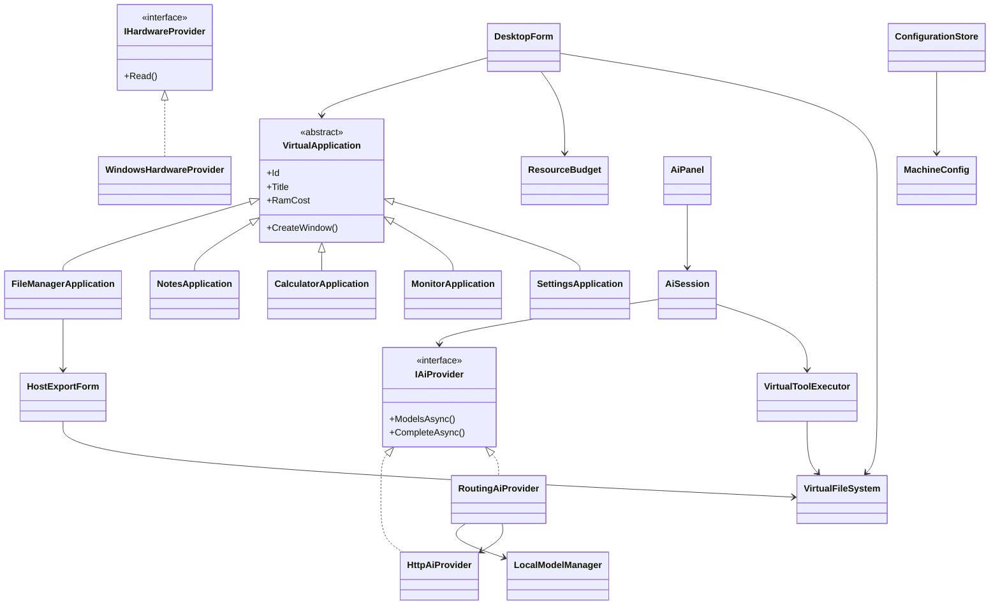

# Derste Kutarya OS'yi anlatma

## Bir cümlede proje

“Gerçek bilgisayarın donanımını okuyup sanal kaynak sınırları belirleyen,
kalıcı dosya sistemi ve AI destekli araçları olan bir C# Windows Forms
masaüstü simülasyonu geliştirdim.”

Gerçek sanal makine/hypervisor iddiası kullanma. RAM seçimleri fiziksel tahsis
değil bütçedir; dosyalar ve depolama kontrolü gerçektir.

## Kavram → kod → gösterim

| OOP kavramı | Sınıf veya sözleşme | Derste göster |
|---|---|---|
| Kapsülleme | MachineConfig | Alanlar getter; geçersiz değer kurucu/fabrika tarafından reddedilir |
| Kapsülleme / yaşam döngüsü | ResourceBudget | Acquire ile bütçe, IDisposable ile uygulama kapanınca iade |
| Soyutlama | IHardwareProvider | UI Windows API ayrıntılarını bilmez |
| Soyutlama | IAiProvider | RoutingAiProvider ile yerel native model veya kullanıcının API’si seçilir |
| Bileşim / yaşam döngüsü | LocalModelManager | Doğrulanmış model indirme, ağırlıkları bir kez yükleme, kaynakları kapatma |
| Kalıtım | VirtualApplication | Ortak Id/Title/RamCost; uygulamalar aynı tabandan türetilir |
| Çok biçimlilik | CreateWindow | Uygulama yöneticisi ortak sözleşmeyle pencere açar |
| Bileşim | DesktopContext | Cihaz, dosyalar, bütçe ve AI tek bağlamda birleştirilir |
| Olay tabanlı programlama | Files.Changed | AI dosya yazınca açık masaüstü ve dosya yöneticisi güncellenir |
| Asenkron programlama | ImportMoveAsync, ExportMoveAsync, ChatAsync | Model ve dosya işlemleri UI kilitlemeden beklenir ve iptal edilebilir |
| Yetki / sorumluluk ayrımı | VirtualToolExecutor, HostExportForm | AI yalnız Masaüstünde çalışır; ana PC hedefini yalnız kullanıcı seçer |
| Hata yönetimi | IOException / GuardAsync | Kota, kilit, bağlantı hatası gerçek sonuçla gösterilir |

## Sınıf haritası

## 7 dakikalık sunum akışı

1. İlk kurulum: cihaz adı, gerçek RAM/GPU/disk sınırları. Kurulumu gösterirken
   önceden kullandığın veri klasörünü silme; yeni bir --data klasörü seç.
2. Masaüstü: Windows görev çubuğu, Pardus benzeri sade menü, özgün duvar kâğıdı.
3. Not defteri: bir dosya yaz ve kaydet; dosyanın klasörde görünmesini göster.
4. Dosya taşıma: SADECE sunum için oluşturduğun bir kopyayı sürükle.
   Gerçek kaynağın kaybolduğunu, hedef içeriğinin aynı kaldığını göster.
5. Çöp kutusu: sanal dosyayı sil ve geri yükle.
6. Kaynak izleyici: uygulama aç/kapat; sanal bütçe artış ve iadesini göster.
7. Yerel modeli önceden indir/seç. Paneli açınca otomatik yüklemeyi göster.
   Önce Masaüstünde klasör, sonra ayrı mesajla kısa metin dosyası iste; Dosyalar'da aç.
   Klasörü seçip Ana PC'ye taşı düğmesiyle kendin dışarı aktar. AI'a Belgeler'de
   dosya yazdırmayı dene; kodun sınır ihlalini reddetmesini göster.
8. Kod: VirtualApplication ve IAiProvider üzerinden kalıtım/soyutlama;
   VirtualFileSystem Changed üzerinden olayları anlat.

## Dosya taşıma neden sıradan File.Move değil?

Hedef dolu, kaynak kilitli veya kopyalama yarıda kalmış olabilir. ImportMoveAsync
kota kontrolü, kilitli kaynak tanıtıcısı, geçici kopya, SHA-256 eşitliği ve
hedef kalıcılığından sonra aynı tanıtıcıyla kaynak silme kullanır.
Bu süreç hem veri güvenliğini hem istisna/async/IDisposable konularını gösterir.

ExportMoveAsync klasör ağacını ve boş klasörleri korur. Kaynak dosyaları açık
tanıtıcılarla yazmaya/silmeye karşı kilitler; her hedef dosyayı doğrular. Bütün
kopyalar hazır olmadan hiçbir kaynak kaldırılmaz. Kaynak klasöre aktarım sırasında
yeni öğe eklenirse işlem durur. Silme aşamasında sorun olursa doğrulanmış hedef
korunur ve kalan sanal öğeler bildirilir. Bu bir diskler arası atomik işlem
iddiası değildir; yarım kaldığında veriyi korumayı amaçlar.

## Sonraki geliştirme fikirleri

Bu sürümün dışında: birden fazla cihaz profili, şifreli oturum kilidi,
anlık görüntü/yedek, ana PC'den klasör içe aktarma, sanal terminal komutları ve daha fazla
sanal uygulama. Gerçek hypervisor eklentisi ayrı ve çok daha büyük bir projedir.
